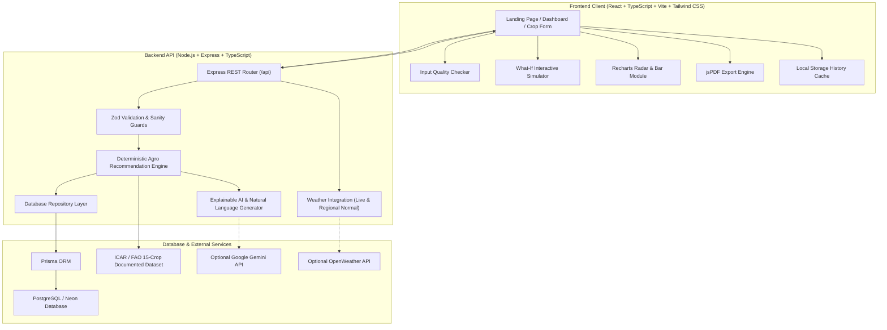

# AgroSmart AI – Architecture & System Design

**Project Name:** AgroSmart AI – Intelligent Crop Recommendation & Decision Support System  
**Problem ID:** HACK-P302  
**Version:** 1.2.0  

---

## 1. System Architecture Diagram

---

## 2. Component Design & Information Flow

### Step 1: Input Ingestion & Quality Guard
- Farmer inputs soil texture, pH, NPK, temperature, rainfall, and season.
- The **Input Quality Checker** assesses values in real-time, warning against extreme acidity (pH < 4.5), excess alkalinity (pH > 8.5), missing NPK data, and thermal stress.
- Zod schemas on the backend enforce structural constraints.

### Step 2: Deterministic Suitability Evaluation
- The recommendation engine loads verified agronomic bands for each crop.
- Trapezoidal continuous scoring functions compute a factor score $S_i \in [0.0, 1.0]$.
- Categorical attributes (soil texture, cropping season) apply verified compatibility multipliers.
- Incomplete inputs are gracefully omitted from the denominator, and an Input Completeness metric is reported.

### Step 3: Explainability & Natural Language Generation
- The engine decomposes the final score into:
  - Favorable contributing factors
  - Bottlenecks or limiting factors
  - Missing data uncertainties
- A deterministic template provides a consistent explanation. If a `GEMINI_API_KEY` is provided, Gemini rewrites the points into simple farmer-friendly language without modifying scores or inventing readings.

### Step 4: Visualizations & Interactive Modeling
- Recharts generates multi-axis Radar charts for resilience benchmarking.
- The **What-If Simulator** allows instant slider adjustments for temperature, rainfall, and soil pH with immediate re-ranking.
- One-click PDF generation compiles a complete field advisory report.
